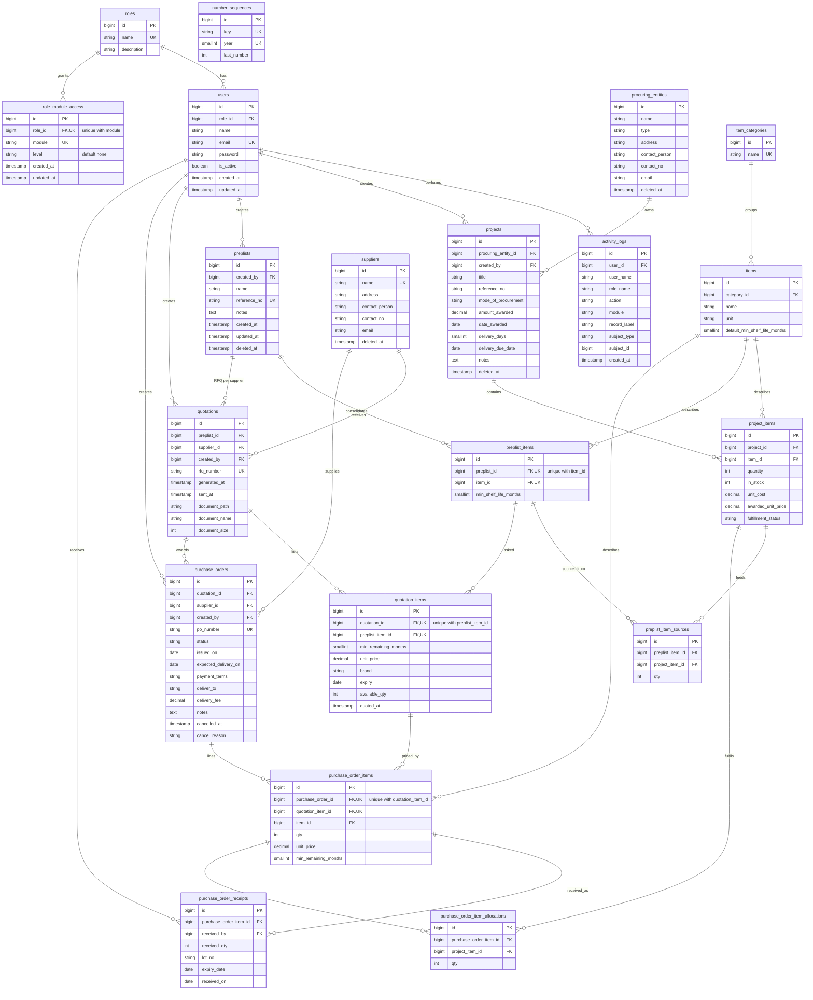

# Purchasing — Procurement Management System

A Laravel 12 application that runs the procurement cycle end to end: **Projects → Prep Lists → Request for Quotation → Quotation tracking → Purchase Orders → Receiving**, plus the supplier / procuring-entity directory, price-index tracking, Excel export, back-up tooling, and settings & privileges. Built for Philippine government-style procurement but works for any institution.

> **Status:** actively developed and proven in a small-team deployment. The procurement chain is functional and database-backed, with role-based access control (None / View / Manage) enforced server-side and reflected in the UI, and activity logging wired across modules. Role × module matrix, settings, and the admin area are Administrator-only. The Price Index is database-backed. Settings → Backup works. See [Project status](#project-status) for an exact, honest breakdown.

---

## Table of contents

- [What this system includes](#what-this-system-includes)
- [Module tour](#module-tour)
- [Database schema](#database-schema)
- [ER diagram](#er-diagram)
- [Table reference](#table-reference)
- [End-to-end flow](#end-to-end-flow)
- [Installation](#installation)
- [Default accounts and seeding](#default-accounts-and-seeding)
- [Configuration details](#configuration-details)
- [Security and access control](#security-and-access-control)
- [Pagination](#pagination)
- [Concurrency: multiple users on one box](#concurrency-multiple-users-on-one-box)
- [Back-ups and restore](#back-ups-and-restore)
- [Testing](#testing)
- [Project status](#project-status)
- [Known limitations](#known-limitations)
- [Layout of the repository](#layout-of-the-repository)
- [Documentation](#documentation)
- [License](#license)

---

## What this system includes

| Module | What it does | Status |
|--------|--------------|--------|
| **Projects** | List / search / create / edit / delete projects; award amount, delivery period, per-item fulfillment tracking; soft-delete; worksheet export (`.xlsx`) and print-ready sheet | ✅ Database-backed |
| **Prep Lists** | Compile one or more Project items into a prep list with minimum shelf-life requirements | ✅ Database-backed |
| **Generate RFQ** | Pick quoted/unquoted items per supplier, generate RFQ `.xlsx` files from a letterhead template (single file or ZIP for multiple suppliers) | ✅ Database-backed, tested |
| **Quotation** | Track supplier quotations grouped by prep list; upload the supplier's returned `.xlsx`; extract prices/brand/expiry per item; short-dated expiry flag; hands off to PO when complete | ✅ Database-backed |
| **Purchase Order** | Create a PO from an awarded quotation (draft); send it; receive lines (full qty per line); cancel with reason; admin-only delete of draft/cancelled; PO moves Draft → Sent → Partially received → Completed automatically | ✅ Database-backed |
| **Entities** | Directory of procuring entities (DOH offices, PGH, …) and suppliers with contact details | ✅ Database-backed |
| **Notifications (bell)** | Delivery-deadline alerts derived from due dates + project fulfillment progress | ✅ Real, data-driven |
| **Role-based access control** | Role × module matrix (None / View / Manage) enforced server-side on every module route; admin bypass; greyed/hidden write affordances for view-only roles; shared access-restricted dialog; friendly 403 page | ✅ Working |
| **Price Index** | Per-item supplier price comparison across quotations: latest quote per supplier, requested quantities from project items, best/average/spread/savings, supplier scorecard, 3/6/12-month trend chart | ✅ Database-backed |
| **Settings → Privileges** | Administrator-only user management **and** the role × module access matrix (None/View/Manage); Administrator rows are locked full access | ✅ Working |
| **Settings → Logs** | Activity/log viewer — real rows from `ActivityLogger` on every module create/edit/delete, plus user/matrix changes; paginated at 50 rows per page | ✅ Working |
| **Settings → Backup** | Full database backup (schema **and** contents) via `App\Support\DatabaseDumper` (through the app's own DB connection — no external `mysqldump`); download or delete any backup; built-in restore instructions on the page | ✅ Working |
| **Excel export** | Project summary export (`.xlsx`) produced by `ProjectSummaryWorkbook`, paired with a print-ready folio view | ✅ Working |

---

## Module tour

### Authentication (`/login`)

- Username/email + password.
- Accounts must be **active** (`is_active = 1`) and have a role assigned.
- Login is throttled (`throttle:6,1` — 6 attempts per minute per IP).
- Expired/inactive sessions are dropped by `EnsureSessionIsActive` middleware.
- Logout via a sidebar button; a confirmation modal prevents accidental logouts.
- Login page reports precisely which field was wrong on failure (no vague “invalid credentials” for known-good accounts).

### Projects (`/projects`)

- One project record per procurement job: title, reference number (`RF-YYYY-NNNN`), procuring entity, mode of procurement (small value, competitive bidding, shopping, …), amount awarded, date awarded, delivery days, optional delivery due date, notes.
- Per-item fulfillment: each project line has quantity, unit cost, awarded unit price, on-hand stock, and `fulfillment_status` (`pending` / `fulfilled`).
- Progress bar shows `fulfilled / total items` with a percentage.
- Search bar filters by title, reference no., or procuring entity (server-side `q`); pagination shows 10 projects per page with the selection persisted across pages.
- View modes: **Content** (card list), **Details** (metadata columns), **List** (dense table) — all paged from the same paginated slice (`?page=`).
- A hidden, folio-sized print sheet renders in print preview (8.5 × 13 in officio, landscape) via a modal; clicking Print calls `window.print()` with the correct `@page` size. The same content streams from `/projects/{project}/download` (`projects.download`) as an `.xlsx` workbook built by `ProjectSummaryWorkbook`.
- Soft-deleted (`deleted_at`) rather than hard-deleted, so links from prep lists survive; cascade rules prevent deleting a sourced project.
- The line-level field `project_items.fulfillment_status` is what progress counts; there is no project-level status enum.

### Prep Lists (`/preplist`)

- Compile one or more project items across projects into a single prep list.
- Each line carries a per-project **minimum remaining shelf life** (months), set at compile time and clamped against the item's `default_min_shelf_life_months`.
- Sources are recorded in `preplist_item_sources` (quantity sourced per project line) — the provenance chain from project → prep list is intact.
- A submitted prep list cannot be deleted while a quotation references it (foreign-key restricted “project is in use” errors surface as friendly validation messages).
- Generating the RFQ from a prep list (`/preplist/{preplist}/generate-rfq`) validates that supplier candidates are chosen and that every item is either quoted or unquoted — nothing partial.

### Generate RFQ (`/preplist/{preplist}/generate-rfq`)

- Choose the suppliers to invite and mark which items are inquoted vs. unquoted.
- Produces one `.xlsx` file per selected supplier from `resources/templates/RFQ-Template.xlsx`;
  - Single supplier → direct download.
  - Multiple → a ZIP containing one `.xlsx` per supplier.
- Per item, the file shows: item number, description, unit, **Min. Shelf Life**, **Brand**, **Unit Price**, **Expiry**, **Remarks** — all blanked for the supplier to fill in.
- Files are named `RFQ-YYYY-NNNN-<SUPPLIER>.xlsx` and stored in `storage/app/private/quotations/` on generation.
- The template explicitly contains **no available-quantity column** — suppliers are never asked for available stock.
- **Service-time** — Excel generation is pure OOXML via `ZipArchive` (no PhpSpreadsheet dependency).

### Quotation tracker (`/quotation`)

- Quotations are grouped by prep list; each quotation row shows the supplier, attached RFQ number, per-item response status, and upload status.
- Upload the supplier's returned `.xlsx` (`POST /quotation/{quotation}/document`, `quotation.store-document`):
  - The file is validated against the RFQ template **before** parsing (header layout + column mapping), so garbage files are rejected with a clear message.
  - The parser reads prices, brand, and expiry per item via `App\Support\QuotationWorkbookParser`; expiry values in any format (`MM/YYYY`, month names, ISO) are normalized by `App\Support\ExpiryParser`.
  - Zero or negative unit prices are rejected at upload time.
- Per-quotation status is computed from priced lines:
  - `Quoted` when at least one priced line exists; `Awaiting quote` otherwise.
  - Short-dated lines (expired or expiring within 30 days) are highlighted in the item breakdown; per-project colour coding compares supplier expiry vs the project's delivery date + minimum shelf life.
- The document can be replaced (`POST /quotation/{quotation}/document`, `quotation.store-document`) — a second file **replaces** the first.
- Delete the document only (`DELETE /quotation/{quotation}/document`, `quotation.destroy-document`) — keeps the quotation row but removes the priced lines; blocked once a PO is generated from it.
- **View-only roles see a disabled "Submit quotation" affordance** (inert button, access-restricted modal on click).
- Re-uploading a document is guarded by a state fingerprint — re-submitting the page against a file another user already replaced is rejected (see [Concurrency](#concurrency-multiple-users-on-one-box)).

### Purchase Order (`/purchase-order`)

- A PO can only be created **from** a quotation, never from nothing; evidence of winning the business lives on the quotation (priced lines), not on the PO itself.
- Allocation across project sources is **proportional** — the PO splits down to the project lines so you know exactly which project it fulfils — recorded in `purchase_order_item_allocations`.
- PO numbers come from the shared `number_sequences` table as `PO-YYYY-NNNN`.
- Status flow: `draft → sent → partially_received → completed` (cancel any time before completion; admin-only delete of draft/cancelled POs).
- Receiving: the checkbox on each line represents “full quantity received for this line”; toggling fires immediately (`onchange`) with a server-side guard against stale state (records the expected pre-toggle state in the request).
- Single-file Excel download at creation; no re-download in this build (see [Not yet done](#not-yet-done)).
- People with view-only roles get the receive checkboxes disabled (greyed, access-restricted modal on click). Unauthorized modification attempts are still blocked server-side by the `module:purchase-order` middleware.

### Entities (`/entities`)

- Tabs for **Procuring Entities** and **Suppliers** (the same `/entities` route selects the tab).
- CRUD with search; soft-delete so historical links survive.
- Only the fields the jurisdiction requires (name, type, address, contact person, contact number, email).

### Price Index (`/priceindex`)

- Database-backed per-item comparison of current supplier quotes.
- Shows: latest quote per supplier, requested quantity (sum over active projects), best / average / spread / savings, supplier count, best supplier name, and a six-month trend per item (minimum 6 months of history; `Slice(-6)`).
- Filters: search by item name, by category, by project (dropdown), and a 3 / 6 / 12-month selector that scopes the trend chart.
- The trend **starts at the month of the first priced quote** within the selected period (not a fixed window) and the y-axis auto-fits the data range; changing the period re-fits both.
- The board renders the **full catalogue** at once — slim rows for every item, with the best supplier highlighted in green and sparing states for unquoted items.
- **Comparison spotlight** opens the detail for whichever item you select: best price suggestion + its expiry, spread-vs-average, savings-at-requested-quantity, brand/expiry per quote, expiry flags (`expired`, `expires soon`), monthly trend chart, and why-not-pick guidance.
- **Best expiry** is surfaced alongside the best price in the spotlight (the latest supplier-stated expiry, shown with severity flags).
- Accessible labels for every control (`sr-only` labels on inputs, `aria-label`s on buttons).
- `module:priceindex` middleware gates the whole module.

### Settings → Privileges (`/settings/privileges`)

- Administrator-only user management: list / search / create / edit / toggle status / delete.
- The delete and toggle operations are protected from self-targeting (you cannot deactivate or delete your own account).
- Separate **Role × Module** matrix (`role_module_access`) with `None / View / Manage` for every seeded role. Administrator is bypassed everywhere — its grants are not editable.
- Changing grants is logged to `activity_logs`.
- Ability to search users live (`GET /settings/privileges/search`).

### Settings → Logs (`/settings/logs`)

- Every module write (create/edit/delete) writes an `activity_logs` row: `user_name`, `role_name`, `action`, `module`, `record_label`, `subject_type`, `subject_id`.
- Filters: module, user, action, from-date, to-date; results paginated 50 per page by default, selectable between 10 / 25 / 50 / 100.
- Nothing is written without an action — the `logs` page is read-only.

### Settings → Backup (`/settings/backup`)

- Back-up page gated by `access-settings` (administrator-only).
- One-click **full** database dump (schema **and** contents) produced through the application's own DB connection (no external `mysqldump` binary required).
- Back-ups stored in `storage/app/private/backups/` with timestamped names; the **15 newest** are kept automatically.
- Download or delete any backup from the page.
- Comprehensive in-page restore instructions written for a **non-technical** admin (readable by any role shift); includes the exact command lines for restoring on the production box.
- On the same page, a plain-language "what to expect" note covers the restore steps (maintenance mode → run the file → read schema counts back).

### Settings → Configuration (`/settings/configuration`)

- Static placeholder — not wired (front-end buttons don't mutate anything).

### Notifications (bell icon)

- Red: due within 2 days / already overdue.
- Amber: due within 7 days with 0 items fulfilled.
- Fuelled entirely by `projects.delivery_due_date` and `project_items.fulfillment_status`; no stored notification rows.
- The bell badge counts projects that are at risk — not “notifications you haven't read”.

---

## Database schema

The schema is 29 migrations deep and is described in full by the ER diagram below. Tables are grouped into **auth/roles**, **catalog**, **procurement/project & prep lists**, **quotation tracker**, **purchase orders**, and **audit**.

### ER diagram



### Table reference

**Auth & roles (4 tables)**

| Table | Purpose |
|-------|---------|
| `roles` | The two seeded roles (`admin` bypassed; `Procurement Officer`, `Viewer` have matrix grants). |
| `role_module_access` | Per role per module grant rows; `level` is `'none'` / `'view'` / `'manage'`. Administrator is implicit and has no rows. |
| `users` | `is_active` gate, `role_id` FK. |
| `number_sequences` | Counter for `RFQ-`, `PL-`, `PO-` sequences per year. |

**Catalog (3)**

| Table | Purpose |
|-------|---------|
| `item_categories` | Groups items (`drugs and medicines`, `supplies and equipments`, …). |
| `items` | The catalogue of orderable goods with `default_min_shelf_life_months`. |
| `procuring_entities` | The buying institutions (DOH Region VII, PGH Manila, …). |
| `suppliers` | External suppliers with contact details. Soft-deleted. |

**Projects / prep lists (4)**

| Table | Purpose |
|-------|---------|
| `projects` | The procurement job. `reference_no` is indexed. |
| `project_items` | Lines inside a project: item, quantity, on-hand stock, awarded unit price. |
| `preplists` | Compiled prep lists (`PL-YYYY-NNNN`). |
| `preplist_items` | Unique `(preplist_id, item_id)` — an item appears at most once per prep list. |
| `preplist_item_sources` | Which project lines each prep-list line is sourced from; preserves provenance. |

**Quotation tracker (2)**

| Table | Purpose |
|-------|---------|
| `quotations` | One row per `(prep list, supplier)` pair — `rfq_number` unique. |
| `quotation_items` | The supplier's prices for each `preplist_item`; unique `(quotation_id, preplist_item_id)`. |

**Purchase orders (4)**

| Table | Purpose |
|-------|---------|
| `purchase_orders` | `status`: `draft`, `sent`, `partially_received`, `completed`, `cancelled`. |
| `purchase_order_items` | Lines from the RFQ to the PO; unique `(purchase_order_id, quotation_item_id)`. |
| `purchase_order_receipts` | Each delivery recorded per unit of price; kept even after full receipt. |
| `purchase_order_item_allocations` | Pro-rated split of each PO line back onto the project lines it fulfils. |

**Audit (1)**

| Table | Purpose |
|-------|---------|
| `activity_logs` | Append-only audit trail; subject_type + subject_id identifies the affected record; used for the Settings → Logs viewer and role-matrix changes. |

---

## End-to-end flow

```
Projects (items + quantities)
        │
        ▼
Prep Lists (compile items across projects, set min. shelf life)
        │
        ▼
Generate RFQ (per supplier; .xlsx letterhead template)
        │
        ▼
Supplier returns the completed file → Quotation tracker → prices read in
        │
        ▼
Proceed to PO → PO created (draft, PO-YYYY-NNNN) → Excel PO downloaded
        │
        ▼
Send to supplier → lines received per line item → PO auto-moves Sent → Partially received → Completed
```

### Detailed flow notes

1. **Create a project** — pick a procuring entity, items, per-item quantity and data. The project has no status enum; progress reads `project_items.fulfillment_status`.
2. **Compile a prep list** — select project items across projects and set a **minimum shelf life** per line (clamped to the item default).
3. **Generate the RFQ** — select the suppliers to solicit and click Generate. Single supplier → one `.xlsx`; multiple → a `.zip`. The template hides available quantities and price columns from the supplier.
4. **Upload the supplier's returned file** — the tracker auto-matches each row by item description (case-insensitive, normalized). Unit price ≤ 0 is rejected. Expiry is parsed crash-proof (`09/2026`, `Sep 2026`, ISO…).
5. **Create the PO** — one click from the Quotation screen (manager-only, viewers get the access-restriction modal). The PO is created in `draft` and split proportionally across the projects' lines.
6. **Send the PO** — moves it to `sent`.
7. **Receive lines** — tick the line's checkbox and enter nothing else; the status auto-moves to `partially_received` or `completed`.
8. **Delete / cancel** — delete only in `draft` / `cancelled` (admin-only); cancel allowed anytime.

---

## Installation

### Requirements

- PHP **8.2+** with OpenSSL, Mbstring, Zip, and MySQL (or MariaDB) support.
- Composer.
- Node.js for `npm run build` (Tailwind v4 + Vite).
- MySQL 8 or MariaDB 10.4+ running locally.

### Step-by-step

```bash
# 1. Clone
git clone https://github.com/islacchi/purchasing.git
cd purchasing

# 2. PHP dependencies
composer install

# 3. Frontend dependencies and build
npm install
npm run build

# 4. Environment
cp .env.example .env
php artisan key:generate

# 5. Configure your database connection in .env (MySQL):
#    DB_CONNECTION=mysql
#    DB_HOST=127.0.0.1
#    DB_PORT=3306
#    DB_DATABASE=purchasing_db
#    DB_USERNAME=root
#    DB_PASSWORD=

# 6. Migrate and seed
php artisan migrate
php artisan db:seed

# 7. Serve
php artisan serve
```

Then visit `http://127.0.0.1:8000`. Log in as `admin` / `admin` and **change the password immediately**.

### Default accounts (change after first login)

| Name | Email | Role | Password |
|------|-------|------|----------|
| `admin` | `admin@example.com` | Administrator | `admin` |
| `user1` | `user1@example.com` | Procurement Officer | `user1` |
| `user2` | `user2@example.com` | Viewer | `user2` |

### Configuration details

- **`APP_ENV`** should be `production` in any shared environment; `APP_DEBUG` must be `false` in production.
- **`APP_URL`** in multi-PC use should be the LAN hostname or IP of the box hosting the app (e.g. `http://192.168.x.y:8000`).
- Sessions, cache, and queues all use the `database` driver in this build (see `.env.example`).
- **File uploads** (supplier-returned quotations, RFQs) are stored under `storage/app/private/`.
- **Back-up** files, if produced, land under `storage/app/private/backups/` — see the [Back-ups and restore](#back-ups-and-restore) section.

Seeded module grants: **Procurement Officer → Manage** on all six modules, **Viewer → View** on all six modules, **Administrator** bypasses the matrix entirely (no grant rows). Grants are editable under Settings → Privileges and every change is logged to the activity trail.

---

## Security and access control

### Questions and answers

| Question | Answer |
|----------|--------|
| Who can log in? | Any active account with a role. Inactive users are refused at login. `admin` password must be changed on first deploy. |
| How do roles map? | `Administrator` → full access including Settings and PO delete (locked in the matrix, not editable). `Procurement Officer` / `Viewer` → access per module configured in Settings → Privileges. |
| How is module access configured? | Settings → Privileges → the **Role module access** matrix. None / View / Manage for each of the six modules. Officer defaults to Manage everywhere, Viewer to View everywhere. |
| How is the matrix enforced server-side? | `module:{module}` middleware (`App\Http\Middleware\EnsureModuleAccess`) wraps the six module route groups: `GET`/`HEAD`/`OPTIONS` require **View**, any other verb requires **Manage**. Administrator bypasses. |
| What if a URL is blocked? | Direct URL hits without access get the friendly **403 — Access restricted** page. |
| How is the matrix reflected in the UI? | View-only roles see inert greyed buttons (cursor-not-allowed); modules they cannot view are hidden from the sidebar; blocked actions open a shared amber access-restricted modal. |
| What does Settings gate? | `access-settings` gate (administrator only). |
| Settings → Logs | Real activity rows: module writes and matrix/user changes; browsable with module/user filters. |
| Session lifetime | Inactivity + absolute lifetime enforced by custom middleware. |
| Login throttling | `throttle:6,1` on the login POST route. |
| PO deletion | Restricted to Administrator; only `draft` and `cancelled` orders may be deleted. |
| Prep list deletion | Blocked while any quotation references it. |
| Project deletion | Blocked while any prep-list source references its items. |
| Quotation cancellation | Unattached quotations (never used in a PO) may be deleted by anyone with Manage access; once used in a PO, only Administrators may delete. |

### Notes on the amber dialog

The shared amber dialog (`components/access-restricted-modal.blade.php`) appears for view-only roles on blocked actions. It is decorative — the actual enforcement is server-side regardless. The dialog exists so the button can still be explored without taking the action.

---

## Pagination

Every list that could contain more than a page of data is paginated server-side; per-page selection is available on every paginated screen.

| Screen | Default page size | per_page selector |
|--------|-------------------|-------------------|
| Projects (`/projects`) | 10 | 10 / 25 / 50 / 100 |
| Prep Lists (`/preplist`) | 10 | 10 / 25 / 50 / 100 |
| Quotation tracker (`/quotation`) | 10 | 10 / 25 / 50 / 100 |
| Purchase Orders (`/purchase-order`) | 10 | 10 / 25 / 50 / 100 |
| Settings → Logs (`/settings/logs`) | 50 | 10 / 25 / 50 / 100 |

Selection persists via the query string (`?page=` preserves `q` and `sort`). Price Index does **not** paginate — the whole catalogue is needed for its cross-item aggregation.

---

## Concurrency: multiple users on one box

This is a single-box, multi-user deployment (a LAN box accessed by several staff at once). There is deliberately **no** real-time sync / live push — every page reads fresh from MySQL on load, which is the correct model for this scale.

### What is handled

- **No silent overwrites on hot shared writes.** Three flows carry an optimistic checkpoint:
  - **Receiving a PO line** — the form posts `expected_received` (the pre-toggle state); if the receipt already changed on the server, the toggle is refused and the page prompts to refresh.
  - **Editing a project** — the form posts `expected_project_fingerprint` (md5 over all editable fields and line rows); a stale submit is refused with a clear message.
  - **Uploading a replacement quotation file** — posts `expected_document_fingerprint` (md5 of path/name/size); if another user already replaced the file, the upload is refused.
- **A Refresh button** in the header forces a reload so any user can see others' changes at will.
- **Receiving + tracking are transactional** behind the scenes (`DB::transaction()`), so a half-saved toggle cannot corrupt the PO state.
- **Number sequences** (`number_sequences`) use `lockForUpdate()` when allocating `RFQ-`, `PL-`, `PO-` numbers — two concurrent allocations cannot collide.
- **Unique constraints** on junction tables enforce no-duplicate-rows at the database level.
- **View-only roles** are blocked from writes both at the middleware and the controller layer — a read-only role cannot mutate state even by guessing the route.

### What to watch

- **Last writer wins on edit forms** — only edit forms with no optimistic checkpoint behave this way (Prep Lists, Entities, RFQ regeneration). Two users editing the same prep list simultaneously will see only one's changes after save; the lose is silent but recoverable via the other tab's refresh.
- **Sessions are per-user and persisted in the database.** Logging out actually clears the session entry, not just the cookie.
- **Print + export** regenerate from live data at request time — never read stale snapshots.

---

## Back-ups and restore

### What gets backed up

One-click, full-database **schema + contents** — no external mysqldump binary required; the dump goes through the app's own connection.

### Where back-ups live

`storage/app/private/backups/*.sql`. The filename is `purchasing-<YYYY>-<MM>-<DD>-<HHMM>-<SS>.sql`. Only the **15 newest** are kept.

### Create, download, delete

- **Create**: click **Download Database Back-up** on `/settings/backup`.
- **Download**: click the Download icon next to a backup file in the history table.
- **Delete**: click the Delete button; accept the confirmation prompt.

### Restore (plain-language, for any future admin)

The restore is a one-way door: it **replaces** the current database with the backed-up one. Take a fresh back-up first if you need to keep the current state.

1. Put the system into maintenance mode: `php artisan down`.
2. Open a terminal in the project root and run (adjust paths as needed):
   ```bash
   mysql -h {{ host }} -P {{ port }} -u {{ user }} -p {{ database }} < path/to/backups/purchasing-*.sql
   ```
   (Double-check that you are pointing at the right server and database.)
3. Bring the system back: `php artisan up`.
4. Verify counts in the panel on `/settings/backup` match your current data.

Reminder: the restorer is `mysql`, not `mysqldump`. Running `mysql` against a backup file drops + rebuilds the database; no app-level flag toggles this — it just happens.

Verification checklist after restore:

- Projects, prep lists, quotations, POs visible in lists (counts match expectations).
- `/settings/logs` shows the restored entries with today's timestamp for the back-up entry itself.
- `/purchase-order` shows the restored orders.
- `/priceindex` shows the same prices as before the restore.

Ask any earlier operator which back-up they need; the history table on the page is authoritative.

---

## Testing

```bash
composer run test          # or: php artisan test
```

Every suite feature-tests through `RefreshDatabase` on in-memory SQLite. Current baseline: **201 passed / 1275 assertions**. Quotation upload tests patch worksheet XML inside the generated workbook to simulate supplier submissions.

Role-access tests (`ModuleAccessTest`) cover the seeded grants, server-side middleware enforcement on all module routes, the privileges matrix update flow, sidebar visibility, viewer affordances (inert buttons, restricted dialogs, 403 page), and the admin-bypass rule.

---

## Project status

Legend: ✅ done · 🚧 in progress / not started.

### Done
- [x] **Authentication** — username/email + password, account activation, session inactivity & absolute lifetime enforcement, throttled login, clear login-error messages
- [x] **Entities** — procuring entities and suppliers: list/search/create/edit/delete, soft-delete, stored contact details
- [x] **Projects** — list/search/create/edit/delete, delivery due-date tracking, per-item fulfillment status, progress bar, soft-delete, Excel export & print-ready folio sheet
- [x] **Prep Lists** — list/search/create/edit/delete, item compilation with source quantities, per-project expiry/shelf-life rules, grouped by source project
- [x] **RFQ Excel generation** — letterhead template, dynamic item rows, `.xlsx` download, ZIP for multiple suppliers, expiry/brand/unit price/shelf-life fields pre-labelled
- [x] **Quotation** — database-backed tracker (grouped by prep list), supplier-file upload with strict template validation, per-item price/brand/expiry extraction, per-project expiry-vs-delivery colour coding, short-dated warning, delete/replace the uploaded file (doesn't delete the entry), optimistic fingerprint guard on re-uploads
- [x] **Purchase Order** — create from awarded quotation (proportional allocation across project sources), draft → Sent → Partially received → Completed, cancel with reason, admin-only delete of draft/cancelled POs, Excel download on generation
- [x] **Price Index** — per-item comparison built from priced quotation lines: latest quote per supplier, requested quantities from project items, best/average/spread/savings, supplier scorecard, real monthly trend with a functional 3/6/12-month filter, comparison spotlight (best price + best expiry)
- [x] **Pagination** — every row-based list paginates server-side with adjustable per-page size (Projects, Prep Lists, Quotation, Purchase Orders, Settings → Logs)
- [x] **Optimistic concurrency** — three hot paths guarded: PO receipt toggle (state snapshot), project edit (fingerprint), quotation document re-upload (fingerprint)
- [x] **Delivery notifications** — header bell feed from due dates + fulfillment progress (red: due ≤ 2 days or overdue, amber: due ≤ 7 days with zero items fulfilled)
- [x] **Excel export** — project summary as `.xlsx` (plus printable folio view)
- [x] **Data-integrity guards** — a project cannot be deleted while sourced into a prep list; a prep list cannot be deleted while referenced by a quotation; a quotation cannot be deleted once quoted (upload removal is separate)
- [x] **Unique junction indexes** — composite unique constraints on `preplist_items` / `quotation_items` / `purchase_order_items`; duplicate key violations surface as validation errors
- [x] **Expiry normalization** — supplier `.xlsx` expiry cells (`MM/YYYY`, month names, ISO dates) parsed crash-proof by `App\Support\ExpiryParser`; expiry columns are real `DATE` columns
- [x] **Role-based access control** — `role_module_access` matrix (None / View / Manage) configured from Settings → Privileges; enforced by the `module:{module}` middleware
- [x] **Role-aware UI affordances** — view-only roles see inert greyed buttons and access-restricted dialogs; sidebar hides modules a role cannot view
- [x] **Activity logging** — module writes recorded; Settings → Logs viewer is live (filterable, paginated)
- [x] **Settings → Backup** — administrator-only full-database backup with plain-language restore instructions in-place
- [x] **Tests** — 201 passing (1275 assertions)

### Not yet done
- [ ] **PDF export** — both PO and RFQ have a “Download PDF” button but it is not wired (no PDF library in the project yet)
- [ ] **Partial receipts** — receiving is all-or-nothing per line; `purchase_order_receipts` already has `received_qty`, `lot_no`, `expiry_date`, but the UI doesn't capture them
- [ ] **PO re-download** — the PO Excel is produced once at creation; there's no way to re-download it from the detail page
- [ ] **PO tracking reference numbers** — PO only references the quotation; PO→project links via allocations are not yet surfaced on the PO detail page
- [ ] **Notifications** are computed on every page view; there's no persisted notification log or read state
- [ ] **Activity log retention** — the activity trail is unbounded; no pruning/archival policy yet
- [ ] **PhpSpreadsheet migration** — if `ext-gd` is enabled later, the manual workbook generator can be replaced
- [ ] **Project edit hard-fails (500) once any of its items is compiled into a prep list.** `syncItems()` deletes and re-creates `project_items` on every save; `preplist_item_sources.project_item_id` has a restricted FK, so the delete raises an unhandled FK violation. A merge/update strategy (match by identity, update in place, never drop sourced rows) is required — no test covers this path.
- [ ] **A quotation whose prep list is missing renders a fixed error banner and cannot be re-uploaded or sent to PO.** Only reachable via DB-level preplist deletion or legacy rows predating the delete guard. Recovery is `Preplist::withTrashed()->find($id)->restore()`.
- [ ] **Price Index comparison is per-item, not per-project.** It cannot pick the supplier for a particular project; that decision stays manual.
- [ ] **The activity log is unbounded**; it will grow indefinitely unless pruned.

### Known fragility worth addressing

- **Project edit hard-fails (500) once any of its items is compiled into a prep list.** `syncItems()` deletes and re-creates `project_items` on every save; `preplist_item_sources.project_item_id` has a restricted FK, so the delete raises an unhandled FK violation and the `PUT projects.update` request 500s. A merge/update strategy is required — no test covers this path.
- **A quotation whose prep list is missing renders a fixed error banner and cannot be re-uploaded or sent to PO.** This state is only reachable via DB-level preplist deletion; `PreplistController::destroy` now blocks deletion of sourced prep lists. Recovery is `Preplist::withTrashed()->find($id)->restore()`.
- **Viewers can't Manage their own profile.** Password change/update is admin-only in the current build; viewers cannot reset their own passwords.

---

## Known limitations

Accepted trade-offs in the current build — worth knowing before relying on the numbers:

- **Price Index compares per item, not per project.** The best price, savings estimate, and scorecard reflect the lowest/average quote across all suppliers and projects for that item. They do not decide which supplier each project actually buys from.
- **Requested quantity is an upper bound.** It is the sum of quantities in non-deleted projects; it is not reduced by received PO quantities, stock on hand, or fulfillment status.
- **Savings estimates exclude real-world costs.** They use the requested quantity × (average − best) from current quotes and ignore freight, taxes, lead time, minimum order quantities, unit conversions, and delivery windows. Supplier-stated brand/expiry are shown but not enforced against a project's delivery date.
- **Deleting an uploaded quotation file deletes its priced lines.** The price history derived from those lines cannot be rebuilt from the file afterwards.
- **The trend shows one point per supplier per month** (the latest priced quote within that month). The sparkline compresses the last six monthly best prices; it is not interactive and does not follow the period selector (the selector affects only the trend chart).
- **The Price Index renders the full catalogue on one page.** There is no server-side pagination for the aggregate comparison; filters run client-side, so very large catalogues will load slowly.
- **Chart.js is loaded from the jsdelivr CDN** (4.4.3), not vendored. Without network access the trend chart does not render.
- **Supplier colour is not persisted.** Colours are assigned by sorted supplier order, so adding or removing a supplier can reassign chart colours.
- **Soft-deleted suppliers keep their historical priced lines visible** because the index reads submitted quotation rows. If a supplier's history must remain, restore it under Entities rather than deleting it.
- **Ties count as a win for every tied supplier** in the competitiveness scorecard.

---

## Layout of the repository

```
purchasing/
├── app/
│   ├── Console/Commands/       # db:dump — dev snapshot helper (used for database/purchasing_db.sql)
│   ├── Http/Controllers/       # Auth, Entity, Entities, Projects, Preplist, PriceIndex, PurchaseOrder, Quotation, Settings
│   ├── Http/Middleware/        # EnsureSessionIsActive, EnsureModuleAccess (module:{module})
│   ├── Models/                 # 21 models + casts, scopes, relationships
│   ├── Support/                # RfqQuotationWorkbook, PurchaseOrderWorkbook, QuotationWorkbookParser,
│   │                           #   ExpiryParser, DeliveryNotifications, ActivityLogger, ModuleAccess,
│   │                           #   ProjectSummaryWorkbook, DatabaseDumper, BackupStorage, Pagination
│   └── Providers/              # access-settings gate; view composer feeds the bell icon
├── database/
│   ├── migrations/             # 29 migrations covering the whole domain (seeded role grants, activity logs,
│   │                           #   unique junction indexes, expiry → DATE columns)
│   ├── seeders/                # AdminUserSeeder (admin / user1 / user2 + seeded module grants)
│   └── purchasing_db.sql       # committed dump for the dev snapshot
├── resources/
│   ├── css/                    # compiled CSS entry (Tailwind v4 via Vite)
│   ├── js/                     # compiled JS entry (chart.js, Alpine alternative none — vanilla)
│   ├── templates/              # RFQ-Template.xlsx and PO-Template.xlsx (letterhead documents)
│   └── views/                  # Blade modules mirroring the sidebar; role-aware affordances via canModule()
│       ├── components/         # access-restricted-modal (shared amber dialog)
│       └── errors/             # 403 — friendly module-access page
├── docs/                       # Procurement-flow PDFs; sample RFQ/PO artifacts
├── routes/
│   └── web.php                 # All routes (login/logout public; rest behind auth + session.active;
│                               #   six module groups additionally behind module:{module})
├── storage/app/private/        # Uploaded supplier files and back-ups live here
├── tests/Feature/              # Feature suites per module (incl. ModuleAccessTest, PriceIndexTest, …)
└── public/                     # Vite build, favicon, robots.txt, .htaccess
```

---

## Documentation

- `docs/Procurement-Flow-Project-A.pdf` — end-to-end flow for a sample project
- `docs/Sample-Request-for-Quotation-RFQ-2026-0042.pdf|.xlsx`
- `docs/Sample-Purchase-Order-PO-2026-0117.pdf|.xlsx`
- `docs/Teaching-Guide-Purchasing-System.md` — onboarding guide for new users (this README extends it)

These describe the intended workflow; historical PDFs may reference earlier UI iterations.

---

## License

The Laravel framework is open-sourced under the [MIT license](https://opensource.org/licenses/MIT).
